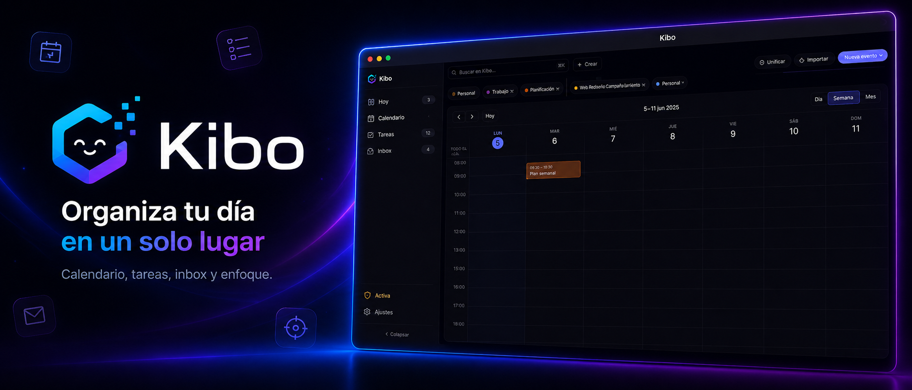
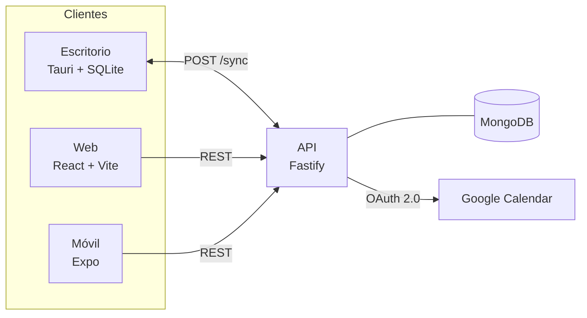

<p align="center">
  
</p>

<h1 align="center">Kibo</h1>

<p align="center">
  <strong>Tu día, tu semana y tu foco — en una sola app.</strong><br />
  Calendario, tareas, inbox y modo concentración en un flujo único. Local-first, de código abierto.
</p>

<p align="center">
  <a href="./LICENSE"></a>
  
  
  
  
</p>

<p align="center">
  <a href="https://kibo.markox.dev">🌐 Probar en la web</a>
  &nbsp;·&nbsp;
  <a href="https://github.com/Markox36/kibo-releases/releases">⬇️ Descargar la app de escritorio</a>
</p>

---

## Índice

- [¿Qué es Kibo?](#qué-es-kibo)
- [Funcionalidades](#funcionalidades)
- [Plataformas](#plataformas)
- [Arquitectura](#arquitectura)
- [Estructura del monorepo](#estructura-del-monorepo)
- [Puesta en marcha](#puesta-en-marcha)
- [Variables de entorno](#variables-de-entorno)
- [Scripts útiles](#scripts-útiles)
- [Despliegue de la API](#despliegue-de-la-api)
- [Seguridad](#seguridad)
- [Hoja de ruta](#hoja-de-ruta)
- [Contribuir](#contribuir)
- [Licencia](#licencia)

---

## ¿Qué es Kibo?

Kibo es una app de productividad personal para quienes viven pegados al calendario pero no quieren doce herramientas distintas para organizarse. Fusiona **calendario**, **tareas**, **notas rápidas** y **modo concentración** en una sola vista.

- **Profesionales y creadores** que necesitan bloquear tiempo real para tareas, no solo listarlas.
- **Estudiantes** que combinan clases, entregas y estudio.
- **Freelance / autónomos** que separan contextos por categorías y calendarios.
- Cualquiera que use Google Calendar y quiera algo más ligero encima.

## Funcionalidades

### Hoy
Saludo dinámico, anillo de progreso, próximo evento con cuenta atrás, tareas atrasadas, inbox pendiente y agenda con línea **AHORA** en tiempo real, mezclando eventos y tareas.

### Calendario
- Vistas **día · 3 días · semana · mes** que se adaptan al ancho de pantalla.
- Drag & drop y resize de eventos y tareas sobre el bloque horario.
- Eventos recurrentes (RRULE), filtros por tipo y por calendario, colores configurables.
- Modal de detalle con edición rápida.

### Tareas
- Prioridades **P1 / P2 / P3**, subtareas con progreso, categorías y etiquetas.
- Planificación con fecha y hora (bloquea el calendario) o solo fecha; vencimiento independiente.
- Estimación en minutos y nivel de energía por tarea.
- Planificador diario con indicador de carga (`@kibo/planning`).

### Inbox
Captura sin fricción: anota ideas ahora, procésalas después.

### Modo Concentración
Pomodoro configurable (trabajo / descansos / ciclos), temporizador libre y reproductor **lofi** integrado.

### Notificaciones
Recordatorios de eventos, tareas planificadas y vencimientos con aviso previo configurable. Notificaciones nativas del sistema.

### Integraciones
- **Google Calendar**: importa calendarios y eventos; los tokens se guardan cifrados en el servidor.
- **ICS**: importa desde archivo o URL y exporta tu calendario a `.ics`.

### Papelera y backup
- Papelera con restauración, vaciado manual y purga automática por antigüedad.
- Export / import en JSON y CSV.
- **Backup cifrado** con passphrase (AES-256-GCM + Argon2id) para mover datos entre dispositivos.

## Plataformas

| Plataforma | Tecnología | Estado |
|---|---|---|
| 🖥️ Escritorio (Linux, macOS, Windows) | Tauri 2 + React + SQLite local | Disponible |
| 🌐 Web | React + Vite | Disponible |
| 📱 Móvil (Android / iOS) | Expo + React Native | En desarrollo |
| ⚙️ API | Fastify + MongoDB | Disponible |

**Requisitos de escritorio:** Linux con `webkit2gtk 4.1`, `gtk3` y `libayatana-appindicator` · macOS 11+ · Windows 10+ con WebView2.

## Arquitectura

Kibo es **local-first**: la app de escritorio guarda todo en SQLite y funciona sin conexión. Si inicias sesión, sincroniza con la API.



- **Sync**: cola de cambios local en el cliente; el servidor aplica *last-write-wins*, informa de conflictos y mantiene un `change_log` (TTL 90 días) con cursor ULID. Si el cursor queda fuera de ventana, el cliente recibe `FULL_RESYNC_REQUIRED` y hace un snapshot completo.
- **Contratos compartidos**: los esquemas Zod de `@kibo/shared` se usan en cliente y servidor, así que validación y tipos son los mismos en todas partes.
- **Borrado lógico** (soft delete) en todas las entidades.

## Estructura del monorepo

Monorepo con **pnpm workspaces** y **Turborepo**.

```
kibo/
├── apps/
│   ├── api/        # API REST (Fastify, MongoDB, JWT, SMTP, Google OAuth)
│   ├── web/        # Cliente web (React, Vite, TanStack Router/Query, FullCalendar)
│   ├── desktop/    # App de escritorio (Tauri 2, Rust, SQLite, sync engine)
│   └── mobile/     # App móvil (Expo, React Native, NativeWind)
└── packages/
    ├── shared/     # Esquemas Zod, enums, DTOs de sync, ULID, i18n
    ├── planning/   # Lógica de planificación y carga diaria
    ├── editor/     # Editor y visor Markdown
    ├── ui/         # Componentes UI compartidos
    └── config/     # tsconfig y ESLint base
```

## Puesta en marcha

### Requisitos

- **Node.js** ≥ 20
- **pnpm** 11.5.1 (`corepack enable` lo instala según `packageManager`)
- **MongoDB** (local, Docker o Atlas) para la API
- Para el escritorio: **Rust** estable y las [dependencias de Tauri](https://tauri.app/start/prerequisites/)
- Para el móvil: Android Studio / Xcode según plataforma

### Instalación

```bash
git clone https://github.com/Markox36/kibo.git
cd kibo
pnpm install
pnpm --filter @kibo/shared build
```

### Configuración

Copia los ficheros de ejemplo y rellénalos (ver [variables de entorno](#variables-de-entorno)):

```bash
cp apps/api/.env.example     apps/api/.env
cp apps/web/.env.example     apps/web/.env
cp apps/desktop/.env.example apps/desktop/.env   # solo si usas el escritorio
cp apps/mobile/.env.example  apps/mobile/.env    # solo si usas el móvil
```

Como mínimo, en `apps/api/.env`: `MONGODB_URI`, `MONGODB_DB_NAME` y un `JWT_SECRET` propio (≥ 16 caracteres; genera uno con `openssl rand -hex 32`).

### Ejecutar

```bash
pnpm dev:app       # API + web  →  http://localhost:5173 (API en :3000)
pnpm dev:desktop   # app de escritorio (Tauri)
pnpm dev:mobile    # Expo
```

## Variables de entorno

### API (`apps/api/.env`)

| Variable | Obligatoria | Descripción |
|---|:---:|---|
| `MONGODB_URI` | ✅ | Cadena de conexión de MongoDB |
| `MONGODB_DB_NAME` | | Nombre de la base de datos (por defecto `kibo_dev`) |
| `JWT_SECRET` | ✅ | Secreto para firmar los JWT (≥ 16 caracteres) |
| `JWT_ACCESS_EXPIRES_IN` / `JWT_REFRESH_EXPIRES_IN` | | Caducidad de tokens (`15m` / `30d`) |
| `PORT`, `API_PUBLIC_URL`, `WEB_ORIGIN` | | Puerto, URL pública y origen CORS permitido |
| `SMTP_HOST`, `SMTP_PORT`, `SMTP_SECURE`, `SMTP_USER`, `SMTP_PASSWORD`, `SMTP_FROM` | | Correo de verificación y recuperación de contraseña |
| `GOOGLE_CLIENT_ID`, `GOOGLE_CLIENT_SECRET`, `GOOGLE_OAUTH_REDIRECT_URI`, `GOOGLE_DESKTOP_CLIENT_ID` | | Login e integración con Google (opcional) |
| `INTEGRATIONS_KEY` | | 64 caracteres hex (32 bytes) para cifrar tokens de integraciones; `openssl rand -hex 32` |
| `ADMIN_EMAIL` | | Email del único usuario con acceso a los endpoints `/admin`. Sin valor, no hay admin |

### Clientes

| App | Variables |
|---|---|
| Web | `VITE_API_URL`, `VITE_GOOGLE_CLIENT_ID` |
| Escritorio | `VITE_API_URL`, `VITE_GOOGLE_DESKTOP_CLIENT_ID`, `VITE_GOOGLE_CLIENT_ID` |
| Móvil | `EXPO_PUBLIC_API_URL`, `EXPO_PUBLIC_GOOGLE_CLIENT_ID` |

> Para Google necesitas tu propio proyecto en [Google Cloud Console](https://console.cloud.google.com/) con un cliente OAuth. En escritorio usa un cliente de tipo **Desktop app** (PKCE) para no tener que incluir un *client secret* en el binario.

> **Nunca** subas ficheros `.env` ni keystores: ya están en `.gitignore`.

## Scripts útiles

```bash
pnpm dev            # todo en modo desarrollo (Turborepo)
pnpm build          # compila todos los paquetes
pnpm lint           # ESLint
pnpm typecheck      # TypeScript
pnpm test           # Vitest
pnpm format         # Prettier

pnpm --filter @kibo/api dev
pnpm --filter @kibo/web dev
pnpm --filter @kibo/desktop build   # empaqueta .deb / .AppImage / .rpm / .dmg / .msi
```

## Despliegue de la API

La API incluye un `Dockerfile` multi-stage y un `docker-compose.yml`:

```bash
# crea apps/api/.env.production a partir de apps/api/.env.example
docker compose up -d --build
```

Expone el puerto `3000` con healthcheck en `/health`. MongoDB no se incluye en el compose: usa Atlas o tu propia instancia.

La web (`apps/web`) es estática y se despliega en cualquier hosting (hay un `vercel.json` de referencia). Las releases de escritorio se generan con el workflow `release.yml` (tauri-action) para Linux, macOS y Windows.

## Seguridad

- JWT de acceso corto (15 min) + *refresh token* con rotación y detección de reutilización.
- Contraseñas con **Argon2**; refresh tokens guardados como hash SHA-256.
- Tokens de Google cifrados en servidor (`INTEGRATIONS_KEY`).
- Backups cifrados en cliente (AES-256-GCM + Argon2id).
- Helmet, CORS y rate limiting en la API; CSP estricta en la app de escritorio.
- Borrado de cuenta (`DELETE /me`) que revoca Google y elimina todos los datos.

¿Has encontrado una vulnerabilidad? **No abras un issue público**: sigue la [política de seguridad](./SECURITY.md).

## Hoja de ruta

- [ ] Tema claro
- [ ] Vista Kanban de tareas
- [ ] App móvil nativa (iOS + Android)
- [ ] Integración con Outlook / iCloud Calendar
- [ ] Compartir workspaces entre usuarios
- [ ] Tests de integración de auth y sync

## Contribuir

Las contribuciones son bienvenidas.

1. Haz un fork y crea una rama (`git checkout -b feat/mi-cambio`). Lee antes la [guía de contribución](./CONTRIBUTING.md).
2. Asegúrate de que `pnpm lint` y `pnpm typecheck` pasan en lo que toques.
3. Abre una Pull Request describiendo el cambio y el motivo.

Para cambios grandes, abre antes un issue para discutirlo. Este proyecto sigue un [Código de Conducta](./CODE_OF_CONDUCT.md).

## Licencia

Código bajo licencia [MIT](./LICENSE) © 2026 Markox.

El nombre y el logotipo de Kibo no están cubiertos por la licencia.

---

<p align="center">Hecho por <a href="https://github.com/Markox36"><strong>Markox</strong></a></p>
